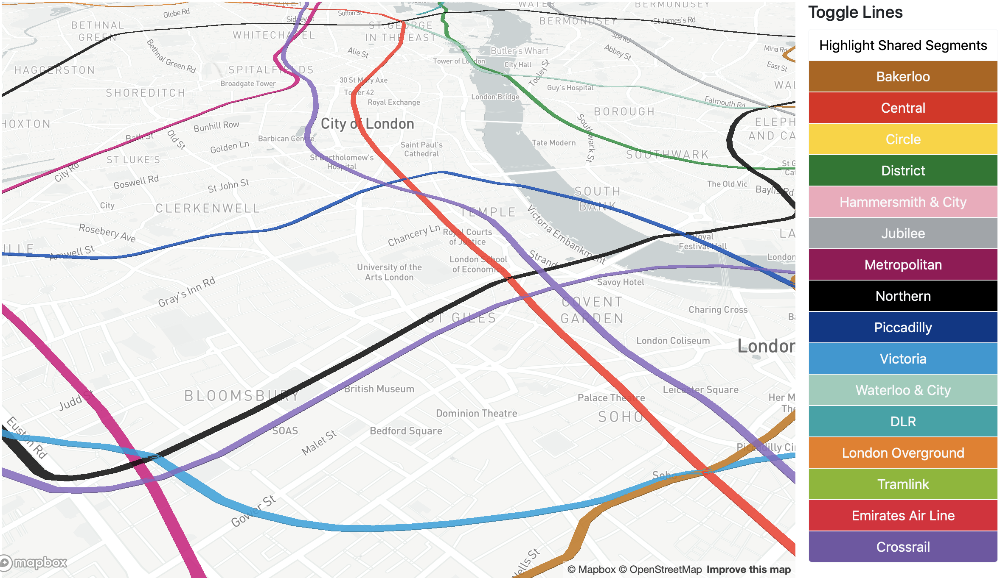

# Why Would You Do This?

Honestly, I have no idea.

## What's There

- Every current TfL rail line, floating 500 m above London: Underground, the six named Overground lines, the Elizabeth line, DLR, trams and the cable car.
- Where lines share track they're stacked rather than drawn on top of each other. "Highlight shared track" picks those segments out.
- Hover (or tap) a line for its name, the stations it runs between and which lines it shares track with. Hover a station for the lines serving it.
- The lighting, sky and shadows follow the sun over London, for now or any time of day. After dusk the map goes dark, and the moon (if it's up) takes over the lighting.
- Settings live in the URL (`?lines=…&height=…&time=…`), and the camera in the hash, so a view can be shared.

## How

The line and station data come from former colleague Ollie O'Brien's [excellent source](https://github.com/oobrien/vis), copied into [`data/`](data/).
MapLibre can only extrude polygons, not lines, so [`scripts/process_lines.py`](scripts/process_lines.py) does the following:

- drops closed and proposed services, such as Crossrail 2 and the Croxley link
- splits the London Overground into its six named lines
- emits one polygon per line per segment, with a stacking level
- works out which stations each segment runs between

The map is [MapLibre GL JS](https://maplibre.org) on [OpenFreeMap](https://openfreemap.org) tiles, with [SunCalc](https://github.com/mourner/suncalc) for the sun and moon.

```bash
npm install
npm run serve        # rebuilds on change, serves on localhost
npm run build        # writes static/script.js etc.
npm run lint
npm run data         # regenerate the GeoJSON (needs uv)
```

Pushes to `master` are built and deployed to GitHub Pages by [a workflow](.github/workflows/pages.yml).

Line colours are in [`lines.json`](lines.json), which both the map and the data script read.

## Further Work

Who can say?

## Closing Thoughts
It's telling that it was easier to get TfL line data from a third party than from an official data store, isn't it?

Line and station data: © Oliver O'Brien, CC BY-NC, derived from © OpenStreetMap contributors (ODbL).
